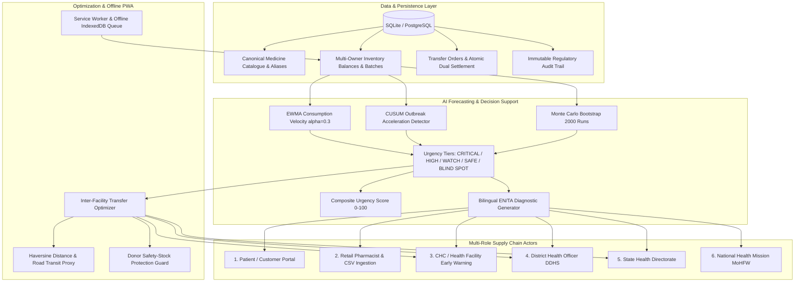

# StockWatch PHC 🏥
### Intelligent Medicine Supply Network & Stock-Out Early Warning System
**Sakthi Hackfest '26 · Problem Statement 6 · SDG 3: Good Health & Well-Being**

> *"Everyone watched the number; nobody watched how fast it was falling."*

StockWatch PHC is a unified, production-grade healthcare inventory intelligence and early-warning network connecting **patients, retail pharmacies, Health Sub-Centres (HSCs), Primary Health Centres (PHCs), Community Health Centres (CHCs), District Health Officers, State Health Officers, and National Health Authorities**.

Instead of waiting for stock to cross arbitrary static reorder thresholds (which fail during sudden disease outbreaks or seasonal surges), StockWatch PHC models **consumption velocity (EWMA $\alpha=0.3$)**, **acceleration (3d/7d trend ratios)**, and executes a **Monte Carlo residual bootstrap (2,000 runs)** to predict stock-outs with sufficient lead time to act within rigid government monthly indent delivery cycles.

---

## 🏛️ System Architecture



---

## 👥 6 User Roles & Demo Credentials

Every role has pre-configured demo credentials with seeded realistic data (Password: `demo123`):

| Role | Username | Password | Jurisdiction / Scope | Key Features |
| :--- | :--- | :--- | :--- | :--- |
| **1. Patient / Customer** | `patient_demo` | `demo123` | Coimbatore Public | Search medicines by generic/brand name, view nearby verified pharmacies on map, check distance & stock availability, submit availability confirmation enquiries. |
| **2. Retail Pharmacist** | `pharma_demo` | `demo123` | Coimbatore Central Pharmacy | Audited stock balances, lot number & expiry tracking (<90d alerts), patient enquiry confirmation queue, idempotent CSV bulk import. |
| **3. CHC / Health Facility** | `chc_demo` | `demo123` | Pollachi CHC / Sub-Centres | AI days-of-cover, consumption velocity & trend, nearby surplus discovery, 1-click inter-facility transfer requests, offline dispensing queue. |
| **4. District Health Officer** | `district_demo` | `demo123` | Coimbatore District (DDHS) | Command Center Matrix (12 PHCs × 8 Medicines), Priority Alerts with 0–100 urgency score, SMS previews, Transfer Network Optimizer, Backtest Accuracy. |
| **5. State Health Officer** | `state_demo` | `demo123` | Tamil Nadu State Directorate | State-wide district comparison, shortage rankings across districts, reporting compliance monitoring, inter-district transfer rebalancing. |
| **6. National Health Officer** | `national_demo` | `demo123` | National Health Mission (MoHFW) | National surveillance across states, Essential Drug Coverage Index (91.7%), Critical Shortage Clusters, Strategic Central CMSS Buffer Allocations. |

---

## 🎨 Clinical Design System

Designed strictly for clinical environments: high information density, calm palette, zero decorative fluff.

- **Theme Palette:**
  - Background: `#F7F9FB`, Surface: `#FFFFFF`, Border: `#E3E8EE`
  - Primary: Deep Teal `#0F6B6B`, Dark Text: `#14202B`, Muted Secondary: `#5B6B7A`
- **Urgency Tiers (Always Icon + Label + Colour, Never Colour Alone):**
  - 🔴 **CRITICAL** (`#C62828`): P(stock-out before action window) $\ge$ 70% or essential medicine escalation.
  - 🟠 **HIGH** (`#EF6C00`): P(stock-out) $\ge$ 40%.
  - 🟡 **WATCH** (`#F9A825`): P(stock-out) $\ge$ 15%.
  - 🟢 **SAFE** (`#2E7D32`): Ample stock buffer.
  - ⚠️ **BLIND SPOT** (`#4A5568`): Stale facilities with no telemetry in $\ge$ 3 days.
- **Typography & Grid:** Inter font, tabular figures for all numbers (`font-variant-numeric: tabular-nums`), 8px grid, 8px border radius.
- **Data Integrity Labels:** Every prediction is labelled *"Estimate"*; every transfer requires authorized human approval.
- **Accessibility:** Instant High-Contrast mode, ARIA badges, full English / தமிழ் (Tamil) bilingual toggle.

---

## 🧠 AI Early-Warning & Algorithmic Engine

### 1. Velocity & Acceleration
- **EWMA Daily Consumption:** $\bar{v}_t = \alpha \cdot v_t + (1 - \alpha) \cdot \bar{v}_{t-1}$ with smoothing parameter $\alpha = 0.3$.
- **Acceleration Ratio:** Compares short-term (3-day) velocity against baseline (7-day) velocity. When acceleration exceeds $+20\%$, urgent escalation triggers regardless of current stock volume.

### 2. Monte Carlo Residual Bootstrap
Runs **2,000 stochastic trajectories** simulating daily dispensing fluctuations and OPD surges to compute:
- Days of cover (P10, P50, P90 percentiles)
- Probability of stock-out before next indent delivery ($T_{\text{indent}} + T_{\text{lead}}$)
- Latest Safe Action Deadline: the critical threshold beyond which emergency action cannot prevent stock-out.

### 3. Inter-Facility Transfer Optimization
- Computes Haversine distance and road transit time between all centres.
- **Donor Safety Protection Invariant:**
  $$\text{Surplus}_{\text{donor}} = \text{Stock}_{\text{donor}} - (\text{Velocity}_{\text{donor}} \times \text{SafetyDays}_{\text{donor}})$$
  Donor facilities are never recommended for transfers if the transfer would push them below their own clinical safety buffer.
- Executes **atomic dual-inventory updates** upon receipt verification.

### 4. Canonical Deduplication Clinical Safety Invariant
- Employs Levenshtein distance and token similarity to detect duplicate trade names and brand aliases.
- **Clinical Safety Guard:** The engine strictly **blocks merges between clinically distinct medicines** (different strengths e.g. 500mg vs 650mg, or different dosage forms e.g. tablet vs syrup), preventing dangerous dosage substitutions while allowing safe brand consolidation.

---

## 🧪 Comprehensive Automated Test Suite

The system includes 39 unit and integration tests covering the complete backend API, forecasting engine, transfer lifecycle, and deduplication rules:

```bash
# Run backend test suite (39 tests, all passing)
py -m pytest tests/
```

Test coverage includes:
- `tests/test_api_and_transfers.py`: Core API endpoints, transfer lifecycles, and surplus thresholds.
- `tests/test_forecast.py`: EWMA calculations, acceleration ratios, Monte Carlo projections, and tier assignments.
- `tests/test_multi_role_and_dedup.py`: Multi-role RBAC, jurisdiction scopes, deduplication clinical safety invariants, and idempotent CSV imports.

---

## 🚀 Quickstart & Setup

### Backend
```bash
# Install dependencies
py -m pip install -r backend/requirements.txt

# Run deterministic database seed generator (Seed 42)
py -m backend.seed

# Start FastAPI server (runs on http://localhost:8000)
py -m uvicorn backend.app.main:app --port 8000 --reload
```

### Frontend
```bash
cd frontend
npm install
npm run build    # Production build
npm run dev      # Development server on http://localhost:5173
```

---

## 🎬 Demo Walkthrough Guide

1. **Public Landing & Patient Discovery:**
   - Open `http://localhost:5173` without credentials to view the Public Portal.
   - Click **"Find Medicines"**: search for *Paracetamol* or *Amoxicillin*, view nearby pharmacies with distance (km), verified source badges (`LIVE_INTEGRATION`, `VERIFIED_PHARMACY`), pricing, and submit an availability enquiry.
2. **Retail Pharmacist Portal:**
   - Log in as `pharma_demo` (or switch role to **Pharmacist** in TopNav).
   - View stock on hand, expiry alerts (<90 days), and confirm patient availability enquiries.
   - Test **Bulk CSV Ingestion**: paste or load CSV inventory with automated preview and idempotent upserts.
3. **CHC & Health Facility Early Warning:**
   - Switch role to **CHC / Health Facility**.
   - Review AI days-of-cover table with EWMA velocities and acceleration trend chips.
   - Click **"Request Transfer"** on a low-stock medicine: inspect nearby donor candidates ranked by distance and surplus buffer, and submit transfer request.
4. **District Health Officer Command Center:**
   - Switch role to **District Health Officer**.
   - Review the **12 PHCs × 8 Medicines Heatmap Matrix**: notice PHC Valparai Paracetamol syrup is marked **CRITICAL with 80 bottles remaining on hand** because burn rate spiked from 4/day to 30/day.
   - Notice PHC Kinathukadavu marked as **⚠️ BLIND SPOT** due to lack of telemetry for 4 days.
   - Click **"Simulate Fever Spike"** in TopNav: watch PHC Anaimalai immediately transition to CRITICAL.
   - Approve inter-PHC transfer from PHC Aliyar (~8.8 km away) with instant forecast recalculation.
5. **State & National Oversight:**
   - Switch to **State Health Officer**: view district comparison matrix and inter-district redistribution directives.
   - Switch to **National Health Officer**: inspect multi-state surveillance and Central CMSS Strategic Buffer reserves.
6. **Bilingual Toggle & Regulatory Audit:**
   - Toggle language to **தமிழ் (Tamil)**: all labels, matrix cells, tooltips, and diagnostic explanations translate seamlessly.
   - Inspect the **Audit Trail** screen with downloadable CSV for complete regulatory compliance.

---

## ⚖️ Clinical Decision Support Notice

> **IMPORTANT:** StockWatch PHC is designed strictly as an intelligent **Clinical Decision Support System (CDSS)**. It does not replace medical authority. Every inter-facility transfer, emergency indent, or stock adjustment requires explicit sign-off and approval from an authorized medical officer or health directorate official.
